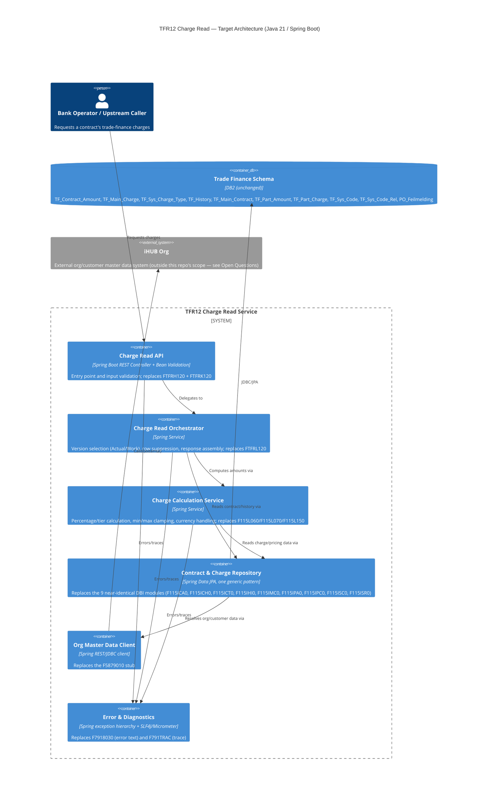
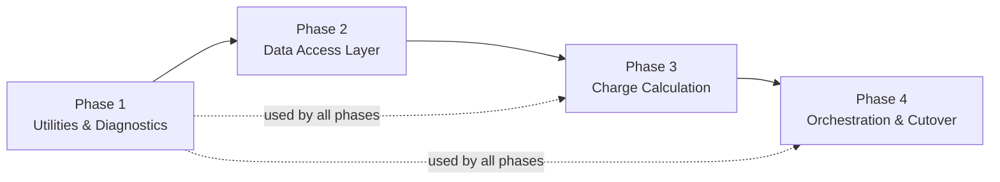

# Modernization Brief — STG/TFR12

**Target stack:** Java 21 / Spring Boot (decided independently for this repo; this brief does not
assume or reuse any other repository's translation pipeline or conventions).

**Inputs used** (regenerate this brief if any of these change): `ASSESSMENT.md` (2026-09-28 15:44),
`topology.json` / `*.mmd` (2026-09-28 14:10), `BUSINESS_RULES.md` (2026-09-28 15:16),
`RULE_REVIEWS.json` (2026-09-28 15:20). No `PREFLIGHT.md`, `INTENT.md` or `DELTA_CATALOG.md` exist
for this system (not run / not applicable — this is a cross-stack rewrite, not a same-stack uplift).

## 1. Objective

TFR12 is a mainframe COBOL "ReadCharge" service (function TFR12/01) that computes and lists
trade-finance charges against a contract — a real, money-affecting calculation, not a report. It is
extracted here as a standalone, well-bounded unit (21 programs, 66 copybooks, ~31K lines) with its
business rules mined and confirmed, purpose-built for a modernization pilot: rewrite it in Java 21 /
Spring Boot, preserving its confirmed behavior exactly, while resolving (rather than silently
carrying forward) the handful of suspected defects the extraction surfaced. This brief is the plan a
steering committee approves and the `transform` phases execute against.

## 2. Target Architecture



| Legacy component | Target component(s) |
|---|---|
| `FTFRH120` (entry point) | Charge Read API (controller, error/trace dispatch) |
| `FTFRK120` (input control) | Charge Read API (Bean Validation + request DTO) |
| `FTFRL120` (business logic) | Charge Read Orchestrator |
| `F115L060`, `F115L070`, `F115L150` | Charge Calculation Service |
| `F115ICA0`, `F115ICH0`, `F115ICT0`, `F115IHI0`, `F115IMC0`, `F115IPA0`, `F115IPC0`, `F115ISC0`, `F115ISR0` (9 DBI modules) | Contract & Charge Repository (one generic Spring Data pattern, not 9 classes) |
| `F5879010` | Org Master Data Client |
| `F7919070`, `F7919100`, `F7919270` | `java.time` (standard library — no bespoke service needed) |
| `F7918030` | Error & Diagnostics (exception hierarchy + message resource bundle for `PO_Feilmelding`) |
| `F791TRAC` | Error & Diagnostics (structured logging / tracing, replacing the MQ trace queue) |
| 9 DB2 tables + `PO_Feilmelding` | Trade Finance Schema (kept as DB2 initially — see Open Questions) |
| `BZXOJOR0` / `BZXOJNA0` (external, not in this repo) | iHUB Org (external system, unchanged) |

## 3. Phased Sequence

Strangler-fig order: foundational/leaf utilities first, then the data-access layer they support, then
the business calculation that depends on data access, then the entry-point orchestration that ties
everything together and is the actual cutover point.



**Phase 1 is a pilot, and this brief is a hypothesis.** Recommended first slice: `F7919100` (date
conversion) — it carries two confirmed P1 policy rules (RULE-036, RULE-037), moderate size, and no
external dangling dependencies, making it a clean first proof that the translation and dual-execution
diff process works end to end. What this pilot surfaces — a COBOL date edge case `java.time` handles
differently, a rounding-mode surprise, a build/test-harness gap — is expected to revise this brief;
regenerating it after the pilot is the normal path, not a failure.

#### Phase 1 — Utilities & Diagnostics
Command: /code-modernization:modernize-transform
Modules: F7919070, F7919100, F7919270, F7918030, F791TRAC
Scale: S
Risk: Low; (1) `F7919100`'s sliding-window century determination (RULE-037) and sub-minimum-date
normalization (RULE-036) are easy to subtly change when reimplemented with `java.time` — mitigate with
characterization tests spanning every century-boundary and sentinel-date case; (2) `F791TRAC`'s MQ
trace payload may have external consumers reading its format — mitigate by confirming with any
downstream trace-queue consumer before changing the payload shape, or preserving it unchanged.
Entry criteria:
- [ ] Pilot module `F7919100` selected and its test fixtures (RULE-036, RULE-037 cases) recorded
- [x] Confirm whether the MQ trace queue (`FDPO.TRACELOG`) has any external consumer to preserve compatibility with — **Answered 2026-09-28: unknown/not confirmed. Proceeding on the assumption of no external consumer; treated as a residual risk to revisit if one surfaces during Phase 1.**
Exit criteria:
- [ ] `F7919070`, `F7919100`, `F7919270`, `F7918030`, `F791TRAC` each pass a dual-execution diff against the legacy module for a representative input set
- [ ] RULE-036 and RULE-037 proven equivalent

#### Phase 2 — Data Access Layer
Command: /code-modernization:modernize-transform
Modules: F115ICA0, F115ICH0, F115ICT0, F115IHI0, F115IMC0, F115IPA0, F115IPC0, F115ISC0, F115ISR0, F5879010
Scale: L
Risk: Medium-High; (1) collapsing 9 near-identical DBI modules into one generic repository pattern
risks silently dropping a per-table nuance (a different key-field set, an Actual/Work switch) —
mitigate with a per-table contract test derived from RULE-016 through RULE-024 before consolidating,
not after; (2) `F5879010`'s real target (the iHUB-Org DBI programs `BZXOJOR0`/`BZXOJNA0`) is outside
this repo slice and cannot be validated here — mitigate by treating Org Master Data as a mocked
integration boundary until the real interface contract is obtained (see Open Questions).
Entry criteria:
- [ ] Phase 1 exit criteria met
- [ ] Pilot table selected among the 9 (recommend `F115ICA0` / `TF_Contract_Amount`, the first alphabetically and a direct P1-rule target) and its contract test written first
- [x] RULE-017's suspected defect (missing `End-Evaluate` silently skips the mandatory Sys-Code key check on Update, `F115ISC0.src:783-813`) triaged: fix it in the target, or reproduce it deliberately — decision recorded here — **Answered 2026-09-29: preserve the gap.** The new code faithfully reproduces the current behavior (no Sys-Code validation on this Update path); not treated as a bug to fix in this phase.
- [x] RULE-029's overloaded status byte (`Has-Been-Settled` 'A' sharing a field with `Incom-Swift` Y/N) triaged before modeling it as a proper field/enum in the target — **Answered 2026-09-29: two separate fields.** `F115IPA0`'s target domain model splits this into two distinct, independently-typed fields, with a mapping-table note that the legacy byte packs both into one COBOL field.
Exit criteria:
- [ ] All 9 DBI modules' read behavior reproduced by the one generic repository pattern, each proven against its table's contract test
- [ ] `F5879010` behavior reproduced against a mocked Org Master Data boundary
- [ ] RULE-016, RULE-018, RULE-020, RULE-021, RULE-027, RULE-028 proven equivalent

#### Phase 3 — Charge Calculation
Command: /code-modernization:modernize-transform
Modules: F115L060, F115L070, F115L150
Scale: M
Risk: High (core financial calculation — 4 of the system's 7 P0 rules live here); (1) COBOL `ROUNDED`
(half-away-from-zero) must match exactly, including for negative amounts — mitigate with a
dual-execution diff against the legacy COBOL over a large sample of real/synthetic contracts, not
unit tests alone; (2) RULE-006's suspected defect (charge currency is relabeled without converting
the amount) needs a decision before this phase's behavior contract is locked.
Entry criteria:
- [ ] Phase 2 exit criteria met
- [ ] RULE-006's suspected defect (currency relabeled without conversion, `F115L060.src:1050-1101`) triaged: fix or preserve — decision recorded here
- [ ] Dual-execution diff harness available (legacy COBOL callable side-by-side with the new service, per `ASSESSMENT.md`'s note that no local COBOL runtime constraint blocks this)
Exit criteria:
- [ ] RULE-001, RULE-002, RULE-003 (percentage/tiered charge calculation, min/max clamping) proven equivalent via dual-execution diff
- [ ] RULE-014 (duplicate/conflicting charge abort) proven equivalent
- [ ] RULE-011 (percent-of-CA basis) confirmed against the RULE-011 SME question resolution

#### Phase 4 — Orchestration & Cutover
Command: /code-modernization:modernize-transform
Modules: FTFRH120, FTFRK120, FTFRL120
Scale: M
Risk: Medium; (1) the ACCEPT-ILC exception path in RULE-015 (never rejects double-billing, unlike
every other operation type) is easy to "fix" by accident during rewrite — mitigate with a dedicated
characterization test for ACCEPT-ILC; (2) this phase is the actual cutover from mainframe to the new
service — mitigate with a shadow/parallel-run period comparing live traffic responses before
switching callers over.
Entry criteria:
- [ ] Phase 3 exit criteria met
- [ ] Shadow-run/parallel-run plan approved for cutover
Exit criteria:
- [ ] RULE-004 (min/max default-value recomputation), RULE-015 (single-payer validation incl. ACCEPT-ILC exception), RULE-026 (Actual/Work version selection) proven equivalent
- [ ] RULE-022, RULE-023, RULE-024, RULE-025, RULE-030, RULE-032 proven equivalent
- [ ] Shadow-run shows no unexplained diffs against legacy for a full representative traffic sample

## 4. Business Walkthroughs

| Persona | What happens (business language) | Legacy modules | Replaced by |
|---|---|---|---|
| Bank operator viewing a contract's charges | Operator asks for a contract's trade-finance charges; the system validates the request, reads the contract and its charge history, computes presentable amounts per each charge's pricing method, resolves access codes, and returns a calculated charge list. | `FTFRH120`, `FTFRK120` → `FTFRL120` → `F115IMC0`, `F115ICA0`, `F115ICH0` → `F115L060`, `F115L070`, `F115L150`, `F115IPA0`, `F115IPC0` → `F115ISC0`, `F115ISR0`, `F115IHI0` → `FTFRL120`, `FTFRH120` | Phase 4 (entry/orchestration) → Phase 2 (data reads) → Phase 3 (calculation) → Phase 2 (lookups) → Phase 4 (response) |
| Support engineer diagnosing a failed charge read | A lookup fails or an invalid code is supplied mid-read; the system builds a localized error message and, if tracing is enabled, writes a diagnostic record before returning an error status to the caller. | `F115ICA0`/`F115L060` (error site) → `F7918030` (message lookup) → `FTFRH120`, `F791TRAC` (trace) → `FTFRH120` (return) | Phase 2/3 (error site) → Phase 1 (message lookup, trace) → Phase 4 (return) |

## 5. Behavior Contract

All 7 P0 rules must be proven equivalent before their owning phase ships. Per `RULE_REVIEWS.md`, the
6 that needed confirmation (Medium confidence or an open SME question) were all confirmed **Right**
by the business owner on 2026-09-28; `RULE-004` was already High confidence with no open question.
**No P0 rule is blocked or under discussion** — none are excluded from this contract.

| Rule | Name | Category | Confidence | Reviewed | Phase |
|---|---|---|---|---|---|
| RULE-001 | Party-specific charge price (POP) priced as of today's date | Calculation | Medium → confirmed | ✅ 2026-09-28 | 3 |
| RULE-002 | Percent-of-amount charge clamped to min/max, percentage recomputed | Calculation | Medium → confirmed | ✅ 2026-09-28 | 3 |
| RULE-003 | Graduated/tiered percentage pricing across amount bands | Calculation | Medium → confirmed | ✅ 2026-09-28 | 3 |
| RULE-004 | Minimum/maximum charge caps with percentage recomputation | Calculation | High | (not flagged) | 4 |
| RULE-014 | Duplicate/conflicting charge detection aborts the transaction | Validation | Medium → confirmed | ✅ 2026-09-28 | 3 |
| RULE-015 | Buyer/seller both charged is not allowed (single payer) | Validation | Medium → confirmed | ✅ 2026-09-28 | 4 |
| RULE-026 | Contract data-version selection (Actual vs Work) | Lifecycle | Medium → confirmed | ✅ 2026-09-28 | 4 |

## 6. Validation Strategy

| Phase | Strategy |
|---|---|
| 1 — Utilities & Diagnostics | Characterization tests (date/timestamp conversion across century and sentinel-date boundaries; error-message lookup fixtures) |
| 2 — Data Access Layer | Per-table contract tests (one per legacy DBI module's key/qualification behavior) before consolidating into the generic repository; dual-execution diff against legacy for each table |
| 3 — Charge Calculation | Dual-execution diff against the legacy COBOL over a large real/synthetic contract sample (this is where money is calculated); property-based tests for rounding, clamping and zero-base edge cases |
| 4 — Orchestration & Cutover | Contract tests on the public request/response shape (`RTFRE120` fields); characterization tests for RULE-004/015/026; shadow/parallel-run manual UAT before full cutover |

## 7. Open Questions

- [ ] **RULE-017 suspected defect** (`F115ISC0.src:783-813`): a missing `End-Evaluate` silently skips the mandatory Sys-Code key validation on Update. Fix it, or faithfully reproduce the gap? Blocks Phase 2.
- [ ] **RULE-006 suspected defect** (`F115L060.src:1050-1101`): charge currency is relabeled without converting the amount when it differs from the contract currency. Fix it, or preserve the current behavior? Blocks Phase 3.
- [ ] **RULE-029 overloaded field** (`copybooks/R115IPA0.copy:180-183`): one byte carries two unrelated meanings (`Has-Been-Settled` 'A' and `Incom-Swift` Y/N). Clarify intended semantics before modeling it properly in the target. Blocks Phase 2.
- [ ] **Org Master Data integration**: `F5879010`'s real dependency (`BZXOJOR0`/`BZXOJNA0`, the iHUB-Org DBI programs) is outside this repo's scope. Need the real interface contract — or an explicit decision to mock it indefinitely — before Phase 2's Org Master Data Client can be built for real.
- [ ] **No production telemetry was available** for the assessment (`ASSESSMENT.md`, Production Runtime Profile). Confirm whether performance/SLA targets exist for the new service before Phase 4 sign-off.
- [ ] **Target persistence assumption**: this brief assumes the 9 DB2 tables + `PO_Feilmelding` stay on DB2 unchanged (JDBC/JPA access only, no data migration). Confirm, or flag if a data-store migration is actually in scope.
- [ ] **RULE-009, RULE-010, RULE-031, RULE-033, RULE-035** and the other Medium/Low-confidence P1 rules listed in `BUSINESS_RULES.md`'s SME section were not asked in this review round (only flagged P0s were). Recommend a follow-up `/code-modernization:modernize-review STG/TFR12 p0` → widen to `all` pass, or review them per-phase as each phase starts.

## 8. Approval Block

```
Approved by: Kristoffer Hellstrand  Date: 2026-09-28
Approval covers: Full plan
```
